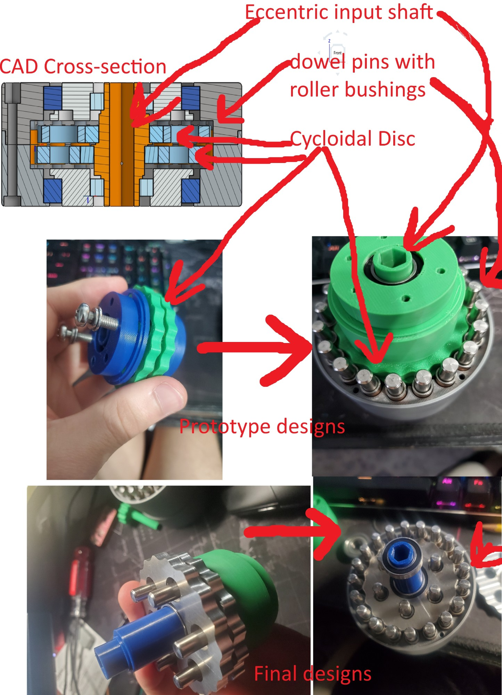
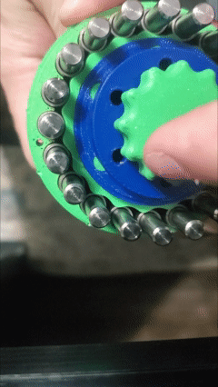
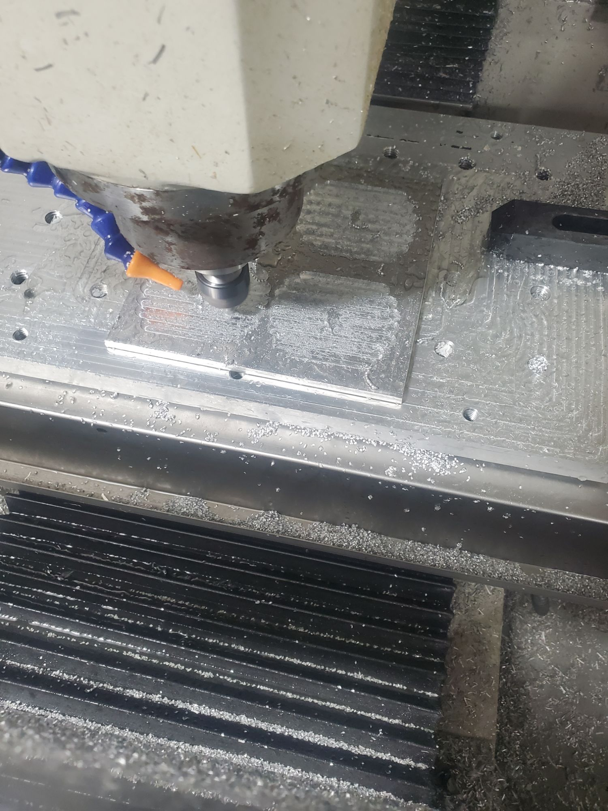
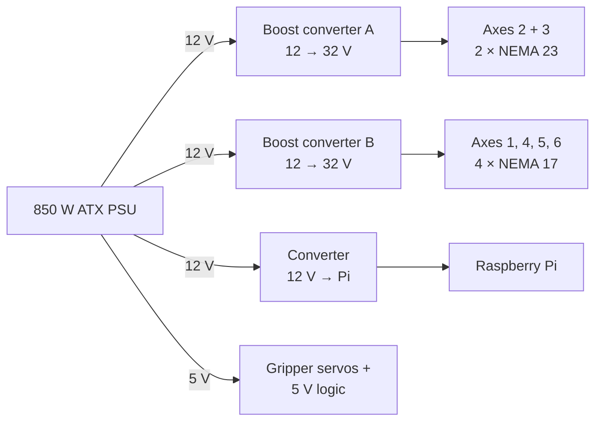

# Hardware Design

This page covers the mechanical and electrical design of the arm: what I built, why I made the major design decisions, and what I'd change in the next revision. For the software, see the [main README](README.md).

**Contents**

1. [Drivetrain at a glance](#drivetrain-at-a-glance), including [belts](#belts)
2. [Cycloidal gearboxes](#cycloidal-gearboxes-axes-2-and-3): construction, designing for efficiency, prototyping
3. [Differential wrist](#herringbone-bevel-gear-differential-wrist-axes-5-and-6)
4. [Gripper](#gripper)
5. [Cable routing](#cable-routing)
6. [Electronics and power distribution](#electronics)
7. [Starting position](#starting-position)
8. [Lessons learned and next revision](#lessons-learned-and-next-revision)

  

The structure is 3D-printed in PLA, combined with off-the-shelf hardware: stepper motors, bearings, belts and fasteners. The cycloidal discs are machined aluminum. I designed the whole arm in [Onshape](https://cad.onshape.com/documents/d0c301e4506d340858f1d1ba/w/f9480a6b56ad6e11bed69cb8/e/ba968be5de3da6f18f08407e).

**Design targets:** a **1 kg payload at 1.2 m reach**, with a safety factor on top. Before starting any CAD, I worked out the torque each joint would need at that load and reach. I took each motor's stall torque at my supply voltage from its datasheet, then chose gear ratios so the torque the motor actually has to deliver is only a fraction of that maximum. That margin is the safety factor. These are design targets; I haven't load-tested the finished arm yet. The resulting motor choices:

- **NEMA 23 steppers** on the shoulder and elbow (axes 2 and 3), which carry the most load.
- **NEMA 17 steppers** on the other four axes.

## Drivetrain at a glance

| Axis | Joint | Motor | Drive | Total reduction |
|---|---|---|---|---|
| 1 | Base turret | NEMA 17 | Belt drive on a V-groove bearing ring | 10 : 1 |
| 2 | Shoulder | NEMA 23 | ≈ 2.5:1 belt → custom **19:1 cycloidal** | ≈ 48 : 1 |
| 3 | Elbow | NEMA 23 | 1.5:1 belt → custom **19:1 cycloidal** | 28.5 : 1 |
| 4 | Forearm roll | NEMA 17 | Belt drive | ≈ 7.1 : 1 |
| 5–6 | Wrist | 2 × NEMA 17 | Belt → **herringbone bevel-gear differential** | ≈ 12.8 : 1 |
| Gripper | Jaws | 2 hobby servos | Servos geared together → four-bar parallel jaws | n/a |

### Belts

Every belt stage uses **GT3 belts with a 3 mm pitch**, chosen over the common HTD 5 mm profile:

- **Printable pulleys.** The GT3 tooth profile prints cleanly, so I could 3D-print all the pulleys.
- **Finer choice of ratios.** The smaller pitch fits more teeth on a pulley of a given size, so there are more tooth-count combinations to choose ratios from.
- **Reliable engagement on small pulleys.** The usual guideline is at least 6 teeth in mesh to keep a belt from skipping. With a finer pitch, even small pulleys stay above that.

**Wrist belts: idlers designed in.** I designed idlers into the two wrist belt drives from the start. They wrap each belt further around its small pulley so more teeth are in mesh, and they let me use belt lengths I could get from my robotics team's stock.

**Elbow belt: tensioning added after the build.** The axis-3 belt came out under-tensioned because small dimensional errors added up across the parts between its two pulleys. The long arm segments made this worse: my Bambu A1's 256 mm build volume meant each long segment had to be printed in pieces and bolted together. To fix it, I drilled holes in the arm structure for an idler that tensions the belt. Tension can also be fine-tuned by printing an idler roller of a different diameter. Next time I'd design adjustable tensioners into every belt drive from the start, as I did on the wrist.

## Cycloidal gearboxes (axes 2 and 3)

The shoulder and elbow drive the two largest, heaviest sections of the arm, so they need the most torque. Each has a NEMA 23 stepper driving a custom 19:1 cycloidal gearbox through a belt. A cycloidal reducer suited these joints for three reasons:

- **High reduction in a small package.** 19:1 in a single stage keeps the joints compact.
- **Very low backlash.** Many pins share the load at once, so there's very little play. That keeps the arm responsive and its movements precise.
- **Practical to make with the tools I had.** The cycloidal disc profile and the pin positions are 2D geometry, so they can be cut accurately on a CNC mill.

  
   <em>Exploded view of the elbow (axis 3) gearbox module.</em>

### Construction

- **20 ring pins and 19-lobe discs** give the 19:1 reduction. Combined with the belt stage in front of each gearbox, that left enough room to tune each joint's ratio and get comfortably more torque than the arm needs.
- **Two cycloidal discs** instead of one. Two discs split the load between more parts for strength and keep vibration very low. A single disc would save some space, but I decided the strength and smoothness were worth more.
- **Thin-section disc bearings (26 × 17 × 5 mm)** fit inside the disc profile while leaving a large enough bore for a strongly eccentric shaft.
- **Eccentric shaft bearings (21 × 12 × 5 mm)** fit into the middle carrier of the gearbox while leaving enough inner diameter for the drive shaft.
- The elbow gearbox is a self-contained module. On the shoulder, the ring pins are built directly into the arm structure instead of a separate housing.

### Designing for efficiency

Efficiency is the usual weak point of cycloidal gearboxes. The disc slides against the ring pins, and that friction wastes motor torque. I made efficiency a main design goal, for two reasons: the motors should deliver as much of their torque to the arm as possible, and less friction makes the arm move more smoothly.

The key decision was how the disc contacts the ring pins:

- **Fixed pins:** the disc slides directly against stationary pins. This is simpler, but it has more friction.
- **Pins with sleeve bushings:** a sleeve around each pin rolls with the disc instead of sliding against it, so there's less friction.

I went through about **seven prototype versions** before settling on the final dimensions. The early prototypes used 3D-printed discs, and the sleeve-bushing version had *more* backlash than the fixed-pin version. That was a real concern. I suspected the cause was the printed disc's imprecise profile rather than the bushings themselves, so I kept the sleeve bushings and planned to machine the final discs. I machined them from **6061 aluminum on a Tormach PCNC 1100** CNC mill. Testing the fully assembled gearbox confirmed my suspicion: with the precise aluminum discs, the extra backlash disappeared.

  
   <em>From CAD cross-section, to printed prototypes, to the final machined aluminum discs.</em>

  
   <em>A printed prototype being turned by hand: the disc rolls around the ring pins.</em>

  
   <em>Machining the discs from 6061 aluminum on the Tormach PCNC 1100.</em>

The aluminum discs do more than make a stronger wear surface. They hold tight tolerances on the disc profile, the part of a cycloidal gearbox most sensitive to inaccuracy. That's what made the lower-friction bushing design work.

**Lubrication:** both sliding interfaces are greased with Super Lube synthetic grease: between each pin and its bushing, and between the bushings and the disc profile. This keeps the bushings rolling smoothly and reduces wear on the discs. The greased surfaces themselves aren't plastic, but I chose a plastic-safe grease so that any grease that spreads onto the surrounding PLA parts won't damage them. I'd used it on earlier 3D-printed projects with no problems.

**Backlash:** roughly **0.5°** per gearbox when first assembled. Extended operation has probably worn the disc surfaces slightly and added a very small amount since then. I don't think it's a significant amount, but I haven't measured it again yet. Re-measuring it, and tracking how it changes with use, is on the list for when I'm back with the hardware.

I also considered a harmonic (strain-wave) drive. It's hard to make a custom one because it depends on a flexible spline that deforms precisely in every rotation, and I couldn't reliably produce that part with the tools I had.

## Herringbone bevel-gear differential wrist (axes 5 and 6)

The wrist was the hardest design decision on the arm, and I'm happy with how it turned out. It had to meet several constraints at once:

- **Packaging:** the motors for the last two axes had to fit somewhere they wouldn't collide with the rest of the arm or limit its range of motion.
- **Weight:** motors mounted at the end of the arm subtract directly from the payload it can lift.
- **Torque:** the motors need enough reduction to rotate the wrist and whatever it's holding.
- **Backlash:** play should stay low.

  
   <em>Cross-section of the wrist differential. Two belt-driven herringbone bevel gears share one shaft and both mesh with the output gear.</em>

**The solution is a bevel-gear differential.** Both motors sit back in the long forearm section and drive the wrist through bevel gears. When they turn the same way, the wrist pitches; when they turn opposite ways, it rotates. Both motors contribute to every wrist movement, so each joint gets the torque of two motors and needs less gear reduction. It also simplified the wiring: there's no motor riding on axis 5 to drive axis 6, so no cable has to cross a moving joint.

**Alternatives I considered:** twisted belt drives, and more cycloidal gearboxes at the wrist. Both would have had less backlash, but they added much more complexity, weight and packaging trouble.

**Trade-off:** bevel gears need some designed-in backlash to run smoothly. Because the wrist links are so short, a small amount of angular play becomes a very small error at the gripper, so the trade-off was worth it.

**Why herringbone:** herringbone teeth transmit torque more smoothly than straight teeth and keep the gears centred on each other. I also expected the herringbone shape to have less backlash than straight-cut teeth when 3D-printed.

**What I'd change:** I'd reduce the backlash designed into the tooth profile. Some of it is needed for smooth meshing, but I think I could remove some and still have the gears run smoothly.

## Gripper

  
   <em>The geared servo horns drive both four-bar linkages together, keeping the jaws parallel and centred.</em>

- **Four-bar linkage.** Each jaw moves on a four-bar linkage, so the jaws stay roughly parallel as they open and close. If the jaws were attached directly to the servo arms, they would swing in an arc and could squeeze an object out of the grip. Parallel jaws hold it in place.
- **Two servos geared together.** I compared the grip force of several motor layouts, and one small hobby servo couldn't supply enough force. I added spur gear teeth to the parts mounted on each servo horn, so the two servos mesh and share the load evenly.
- **Self-centring.** Because the gears link the two sides, the jaws always move symmetrically and the object always ends up centred in the gripper.
- **Swappable TPU grip pads.** Each PLA jaw has a dovetail slot that takes a flexible 3D-printed TPU pad. The pads slide in and out, so I can quickly test and swap different grip designs.

## Cable routing

My main goal was to keep the cables from getting tangled or snagged as the arm moves.

- **Through the forearm:** a channel runs through the centre of the forearm and carries power to the two wrist motors. Near the wrist, the gripper cable leaves the channel at a point where it's hard for it to catch on other parts of the arm.
- **Upper arm:** the cable harness runs up the axis-2 section to the axis-3 motor, held with zip ties looped through holes already in the arm.
- **Connectors:** the motor connectors are hot-glued for strain relief so they can't work loose.

## Electronics

- **Motors:** two NEMA 23 and four NEMA 17 steppers, driven by STEP/DIR stepper drivers at 1/8 microstepping. The Raspberry Pi generates the step pulses (see [Robot_Arm_Controller](https://github.com/Tylr-J42/Robot_Arm_Controller)).
- **Gripper:** two hobby servos driven by PWM from the Pi (see [Gripper](#gripper)).

### Power distribution

Everything runs from a single 850 W ATX PC power supply. Its rails are split by job:

- **Steppers at 32 V.** Two boost converters step the 12 V rail up to 32 V, with the motors split between them by current draw: one converter powers only the two NEMA 23 motors on axes 2 and 3, which draw the most current, and the other powers the four NEMA 17 motors. A higher supply voltage lets the drivers push current into the motor windings faster, so the steppers keep more of their torque at speed than they would at 12 V.
- **Raspberry Pi** is powered by its own converter from the 12 V rail, kept separate from the motor supplies so motor current spikes don't reach it.
- **Servos and 5 V logic** run directly from the PSU's 5 V rail.

## Starting position

The steppers have no encoders and the arm has no limit switches, so it has no way to find its own position. Before each run, I move the arm by hand to a set starting pose that matches the starting pose in the software. Some joints can be pushed against their hard stops, which gives a very repeatable reference. The others are lined up by eye with alignment marks I scribed on the parts at the right angles.

## Lessons learned and next revision

Building this taught me where a 3D-printed design is good enough and where it isn't. These are the changes I'd make in a second version, in priority order:

1. **Rebuild the base turret bearing.** The turret rides on a 3D-printed plate held between four V-groove bearings. Printed parts can't hold tight enough tolerances, and the brackets mounting the bearings to the table weren't stiff enough for the arm's load. The result was visible rocking when the arm moved quickly. A redesigned base would be stiffer: either a commercial slewing bearing or rigid metal bearing mounts.
2. **Keep the elbow's bolted joint from losing clamping force.** Each arm section bolts directly to its cycloidal gearbox output. At the shoulder, the gearbox is bolted from both sides. At the elbow (axis 3), the arm section is cantilevered off one side. I designed that joint with six bolts so the clamping preload would create enough friction to carry the joint's torque, giving a zero-backlash connection without relying on the bolts to fit tightly in their holes.

   After a while, backlash appeared at the elbow, and I traced it to the plastic. The bolts thread into PLA, and under constant bolt pressure the PLA slowly crept (deformed over time). As it crept, the bolts lost preload, the friction could no longer carry the torque, and the bolts started shifting back and forth in their clearance holes. The shoulder (axis 2) uses the same gearbox design and never developed this backlash, which points to the one-sided bolted joint rather than the gearbox. Next time I'd keep the preload in three ways:
   - **More bolts**, for more total clamping force.
   - **Higher infill density** around the joint, so the plastic resists creep.
   - **Brass heat-set threaded inserts**, so the bolts thread into metal instead of plastic.
3. **Stiffen the joint between the two halves of the axis-4 section.** The bolt holes came out poorly because of the print orientation, leaving little plastic for the bolts to thread into, and misalignment from the print meant some holes had to be slotted. That made the joint loose and added play to the whole arm. Next time I'd redesign that joint and use brass heat-set threaded inserts instead of threading bolts into plastic.
4. **Add power supply margin.** With several steppers accelerating at once, the 850 W PC supply couldn't keep up with the current on its 12 V rail and browned out. The boost converters make this worse: to deliver power at 32 V, they draw roughly 2.7× as much current from the 12 V side, plus conversion losses. I had to keep the arm's speed well below what the motors could deliver. Splitting the motors across two power supplies should leave enough headroom to run the arm much faster. With that change, I expect the arm as built could reach its 1 kg / 1.2 m design target.
5. **Add closed-loop feedback.** The steppers run without encoders, so the controller can't detect a missed step. Adding encoders would let the software confirm where the arm actually is. Encoders or limit switches would also allow automatic homing, replacing the manual starting-pose alignment.
