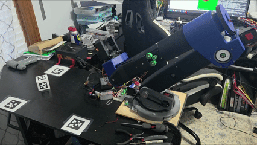
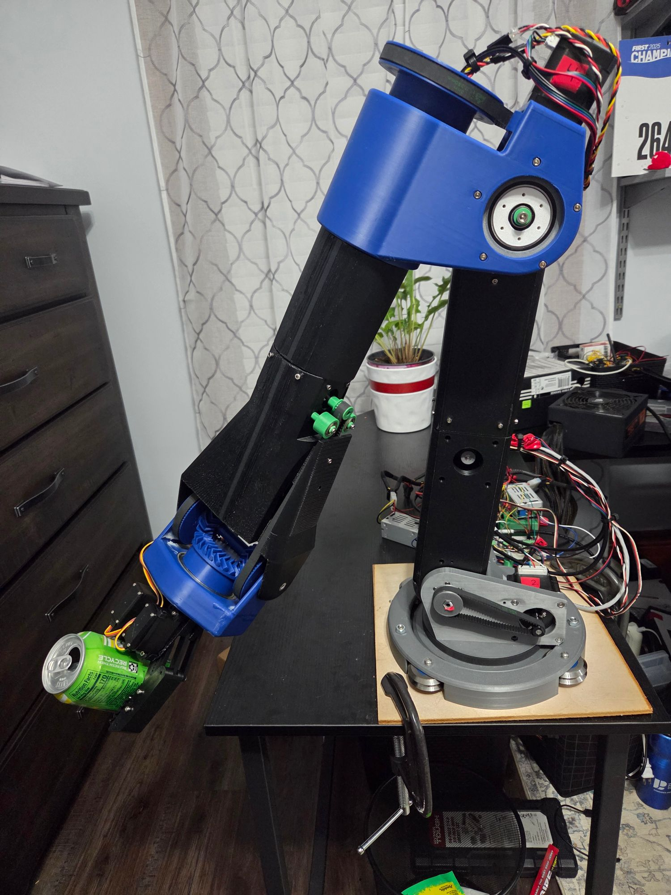
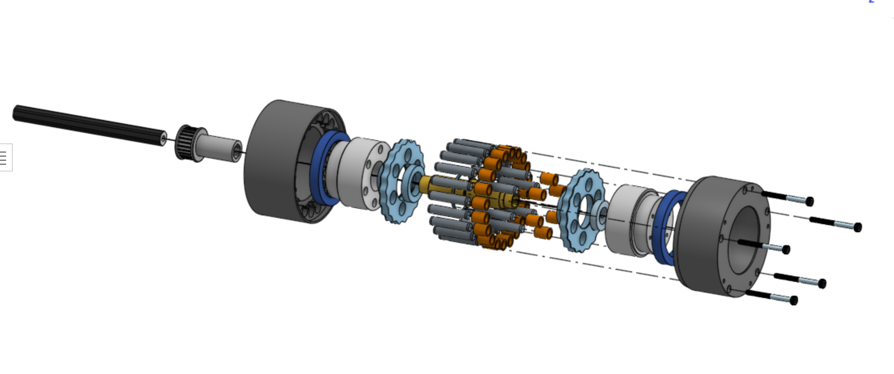
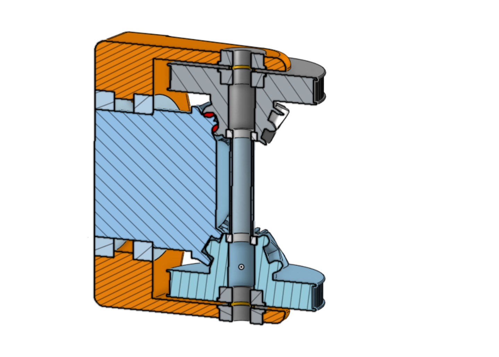
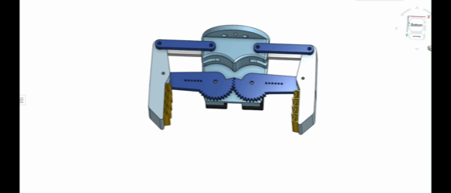
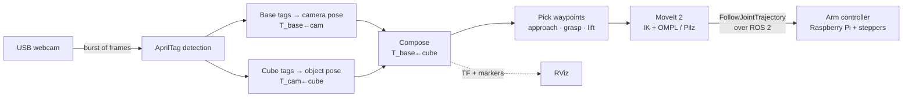
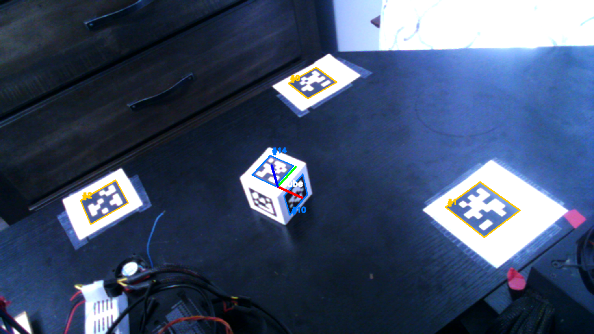
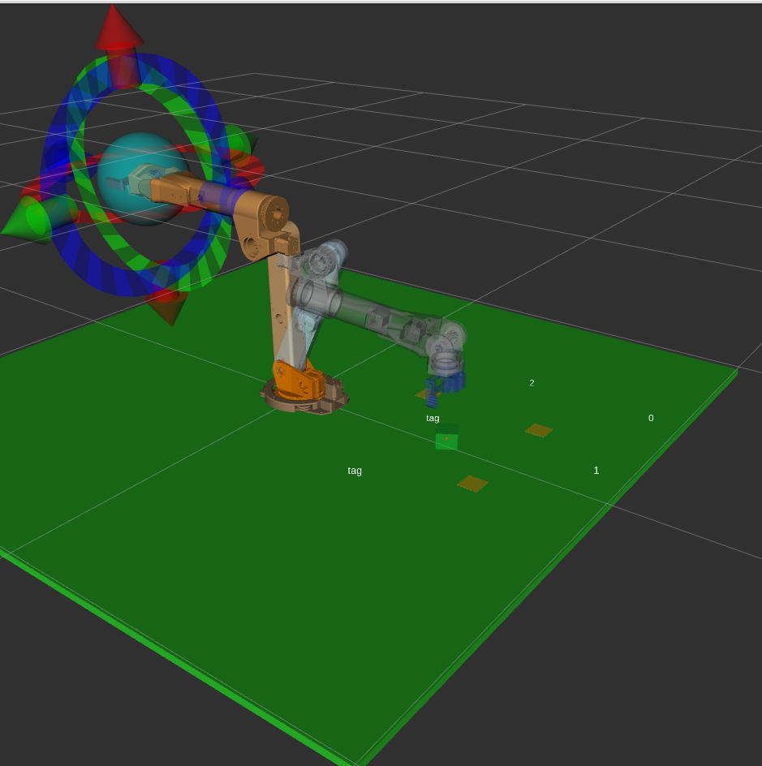

# Vision-Guided 6-Axis Robot Arm

**A 6-axis robot arm I designed, built and programmed from scratch:** custom cycloidal gearboxes, a differential wrist, and vision-guided motion planning with ROS 2 and MoveIt 2.

This is the program for planning and controlling the trajectory of the arm. It takes visual input from a webcam and uses AprilTags to localize the robot in its environment, then moves the arm to pick up objects within reach. Once the trajectory is planned, it is sent to the [robot arm controller](https://github.com/Tylr-J42/Robot_Arm_Controller) over ROS 2.

<p align="center">
  
</p>

> [!TIP]
> **Interested in the mechanical design?** The **[hardware design write-up](HARDWARE.md)** covers the CNC-machined cycloidal gearboxes and how they were prototyped, the herringbone differential wrist, the geared gripper, power distribution, and lessons learned from building the arm.

**Contents:** [Highlights](#highlights) · [Hardware](#hardware) · [How it works](#how-it-works) · [Engineering notes](#engineering-notes) · [Status](#status) · [Tech stack](#tech-stack) · [Repository layout](#repository-layout) · [Running it](#running-it) · [Hardware write-up →](HARDWARE.md)

---

## Highlights

- **Custom mechanical design:** 19:1 cycloidal gearboxes with discs CNC-machined from 6061 aluminum, a herringbone bevel-gear differential wrist and a geared parallel-jaw gripper, all designed in Onshape.
- **Camera calibration on every capture:** the camera's position is solved again from fixed base tags in the same frame that sees the object, so a bumped camera can't quietly throw off the result.
- **Millimetre-level localization:** a ChArUco-calibrated webcam (0.39 px reprojection RMS) and multi-tag PnP place the target to about 1.5 mm in the arm's base frame.
- **Collision-aware motion planning:** MoveIt 2 handles inverse kinematics and planning. OMPL plans the free-space moves and Pilz LIN plans the straight-line grasp descent and retreat.
- **Built-in safety checks:** the arm won't move on a doubtful pose. The code rejects plans that over-rotate the turret, checks that the arm actually arrived after each segment, and saves an annotated diagnostic image when a step fails ([example](docs/media/vision_rejected.png)).

## Hardware

<table>
  <tr>
    <td width="40%"></td>
    <td>

I designed the arm myself in [Onshape](https://cad.onshape.com/documents/d0c301e4506d340858f1d1ba/w/f9480a6b56ad6e11bed69cb8/e/ba968be5de3da6f18f08407e) and built it mostly from 3D-printed parts.

- **6 stepper-driven joints** at 1/8 microstepping, each with its own gear reduction.
- **Custom 19:1 cycloidal gearboxes** on the shoulder and elbow for high torque with very low backlash. The discs are CNC-machined from 6061 aluminum.
- **Belt-driven turret** on a roller-bearing base, with a 450° range of motion.
- **Herringbone bevel-gear differential wrist:** two motors in the forearm work together to drive the last two axes.
- **Parallel-jaw gripper:** two servos geared together drive four-bar-linkage jaws with swappable TPU grip pads (shown holding a can during the pick-and-pour task).
- **Raspberry Pi controller** that generates the step pulses. See [Robot_Arm_Controller](https://github.com/Tylr-J42/Robot_Arm_Controller).

</td>
  </tr>
</table>

<table>
  <tr>
    <td width="33%" align="center"><a href="HARDWARE.md#cycloidal-gearboxes-axes-2-and-3"></a></td>
    <td width="33%" align="center"><a href="HARDWARE.md#herringbone-bevel-gear-differential-wrist-axes-5-and-6"></a></td>
    <td width="33%" align="center"><a href="HARDWARE.md#gripper"></a></td>
  </tr>
  <tr>
    <td align="center"><b><a href="HARDWARE.md#cycloidal-gearboxes-axes-2-and-3">Cycloidal gearboxes →</a></b><br>Seven prototypes, then aluminum discs machined on a CNC mill</td>
    <td align="center"><b><a href="HARDWARE.md#herringbone-bevel-gear-differential-wrist-axes-5-and-6">Differential wrist →</a></b><br>Two motors share the load through herringbone bevel gears</td>
    <td align="center"><b><a href="HARDWARE.md#gripper">Geared gripper →</a></b><br>Four-bar parallel jaws with swappable TPU pads</td>
  </tr>
</table>

<p align="center"><b>→ <a href="HARDWARE.md">Read the full hardware design write-up</a></b>: design decisions, prototyping, and what I'd change next time.</p>

## How it works



1. **Capture.** One burst is captured from a fixed webcam *before* the arm moves. Once the arm starts moving it blocks the camera's view, so the pick is solved once and then executed open-loop.
2. **Localize the camera.** Three AprilTags (tag36h11, 60 mm) sit at measured positions on the arm's base. A PnP solve over all of their corners gives the camera's pose in the `base_assy` frame.
3. **Localize the object.** The target cube has a tag on each face. A second PnP solve gives the cube's pose relative to the camera.
4. **Compose.** `T_base←cube = T_base←cam · T_cam←cube`. The camera drops out of the result, and errors that affect both solves equally partly cancel.
5. **Plan.** The cube pose becomes a sequence of waypoints. The gripper approaches from 15 cm above, comes straight down with the tool pointing at the table, closes, then retreats and lifts. MoveIt 2 plans each segment against a planning scene that includes the table and the cube.
6. **Execute.** Each trajectory goes over ROS 2 to the [controller](https://github.com/Tylr-J42/Robot_Arm_Controller), which turns joint angles into stepper motor steps (including the wrist's differential drive).
7. **Visualize.** The same solve is published to TF and RViz, so what you see on screen is exactly the pose the arm is acting on.

<table>
  <tr>
    <td width="50%"></td>
    <td width="50%"></td>
  </tr>
  <tr>
    <td><b>What the camera sees.</b> Base tags #0–#2 (yellow) locate the camera, the cube tags (blue) locate the cube, and the solved cube frame is drawn as axes.</td>
    <td><b>What MoveIt sees.</b> The same solve in RViz, with the base tags, the cube as a collision object, and the arm planning toward it.</td>
  </tr>
</table>

## Engineering notes

Some of the problems solved along the way. The full list is in [`VISION_PIPELINE.md`](VISION_PIPELINE.md).

- **Silent PnP failure modes.** `SOLVEPNP_IPPE_SQUARE` expects a different corner order than this code uses. Given these points it returns a plausible-looking pose that is 753 mm and 158° off. The fix was to use `SOLVEPNP_IPPE`/`SQPNP` and then refine with VVS.
- **Error budgets in physical units.** At this camera's range, 1 px of reprojection error is about 0.8 mm. Converting the RMS gate to millimetres showed it was 3–4× tighter than the task needed and was rejecting tag maps that calipers confirmed were correct.
- **Calibration coverage beats RMS.** A ChArUco session concentrated in the centre of the image scored *better* RMS but had 10× worse focal-length error.
- **Tool geometry vs. the planning frame.** The gripper tips sit 30.5 mm past the `ee` frame. When the tool points down, ignoring that offset puts the gripper 10 mm under the table and MoveIt rejects the goal as in collision.
- **Ignored execution status.** `MoveItCpp::execute()` was returning `ABORTED` when no controllers were active, and the code was discarding it. The arm then planned later moves from a stale pose. The scripts now check the status and compare the arm's final joint angles against the trajectory.
- **Camera firmware quirks.** On this webcam, manual exposure does nothing in MJPG mode, and V4L2 silently clamps out-of-range settings, so `open_camera` now reads every setting back to confirm it took.

For the mechanical side, including PLA creep at the elbow joint, belt tensioning and power supply limits, see [Lessons learned in HARDWARE.md](HARDWARE.md#lessons-learned-and-next-revision).

## Status

**On hold since September 2026.** The arm stayed home when I moved to university, so hardware development is paused until I can get back to it.

**Where it stands**

- ✅ **Vision:** the cube's pose in the arm's frame is verified against caliper measurements to about 1.5 mm. Camera intrinsics are calibrated to 0.39 px RMS.
- ✅ **Planning:** the full approach → descend → grasp → retreat → lift sequence plans cleanly in MoveIt 2 from a live camera capture.
- ✅ **Execution:** trajectories reach the Raspberry Pi controller over ROS 2 and drive the arm (see the demo above).

**Known limitations**

- The arm is open-loop (stepper motors with no encoders), so the joint states it reports are the *commanded* positions. The software can't detect a missed step or a stall.
- The camera captures once, before the arm moves, because the arm blocks the static camera's view once it starts moving. The pick then runs without visual feedback.
- Grasp orientation is fixed to "tool pointing down." Picking up the cube using the grasp orientation measured from its tags isn't tuned yet.

**Next steps when I'm back on the hardware**

- Add joint encoders for closed-loop position feedback.
- Mount a camera on the wrist (eye-in-hand) so the arm can re-localize during the approach.
- Tune vision-derived grasp orientations, and pick up objects other than the tagged cube.

## Tech stack

| Area | Tools |
|---|---|
| Language | Python 3.12 |
| Robotics middleware | ROS 2, MoveIt 2 (MoveItPy), tf2, RViz |
| Motion planning | OMPL (RRTConnect), Pilz Industrial Motion Planner |
| Computer vision | OpenCV (ArUco/ChArUco, PnP), `dt_apriltags` |
| Math | NumPy, SciPy (`Rotation`) |
| Design & fabrication | Onshape CAD, Bambu Lab A1 (PLA, TPU), Tormach PCNC 1100 CNC mill |
| Hardware | NEMA 23 / NEMA 17 steppers, Raspberry Pi controller, Rocketfish HD USB webcam |
| Earlier prototypes | PyTorch gradient-based IK, PyBullet IK |

## Repository layout

<details>
<summary>File-by-file overview (click to expand)</summary>

| File | Purpose |
|---|---|
| `moveit_pick_cube.py` | **Main task:** one capture → TF + planning scene → MoveIt pick sequence |
| `pick_cube.launch.py` | Runs the pick with the MoveIt config parameters loaded |
| `moveit_pick_and_pour.py` / `pick_and_pour.launch.py` | Earlier waypoint-based pick-and-pour task (supplies the shared motion helpers) |
| `scene_solve.py` | Composes the base and object PnP solves into an object pose (no camera or ROS imports) |
| `camera_extrinsics.py` | PnP solver, pose averaging, leave-one-out outlier diagnosis |
| `tag_map.py` | Loads and checks tag maps, tag corner geometry |
| `apriltag_detect.py` | AprilTag detector wrapper and filtering |
| `camera_capture.py` | Camera access, settings readback, burst capture |
| `cube_pick_target.py` | Turns a cube pose into approach, grasp and lift waypoints |
| `locate_cube.py` | CLI: capture → solve → report, with a verification overlay and failure diagnosis |
| `camera_tf_publisher.py` | ROS 2 node that broadcasts the live camera and cube frames to TF |
| `calibrate_intrinsics.py` | Guided ChArUco intrinsic calibration |
| `calibrate_camera_extrinsics.py` | Checks the base tag map |
| `tune_camera.py` | Sweeps camera settings, scored by how many tags are detected |
| `make_apriltags.py`, `make_cube_net.py`, `make_charuco_board.py`, `pdf_sheet.py` | Generate printable vector PDFs of tags, the cube wrap and the calibration board |
| `tags_base_assy.yaml`, `cube_tags.yaml`, `camera_intrinsics.yaml`, `constants.py` | Calibration and tag map data |
| `VISION_PIPELINE.md` | In-depth design notes and engineering findings |

The vision modules (`tag_map`, `camera_extrinsics`, `scene_solve`) depend only on NumPy, OpenCV, SciPy and PyYAML, so the CLI tools and the ROS 2 nodes share the same code unchanged.

</details>

## Running it

**Prerequisites:** ROS 2 with MoveIt 2, the `tyler_arm` MoveIt config package generated from the arm's URDF, and a Python venv with `numpy`, `opencv-contrib-python`, `scipy`, `pyyaml` and `dt-apriltags`.

```bash
# 1. Print the tags (print the PDFs at 100% / actual size)
./venv/bin/python make_apriltags.py --family tag36h11 --ids 0,1,2
./venv/bin/python make_cube_net.py --cube 0.060

# 2. Calibrate the camera once
./venv/bin/python calibrate_intrinsics.py --save-dir ./cal_pics

# 3. Check that the vision works without moving the arm
./venv/bin/python locate_cube.py --display --verify
```

```bash
# Terminal 1 (dev machine): move_group + RViz
ros2 launch tyler_arm bringup_real.launch.py

# Terminal 2 (Raspberry Pi): arm controller, see the controller repo
python3 arm_pi_node.py

# Terminal 3 (dev machine): plan and preview only, then run for real
ros2 launch ./pick_cube.launch.py plan_only:=true
ros2 launch ./pick_cube.launch.py
```

## Related repositories

- **[Robot_Arm_Controller](https://github.com/Tylr-J42/Robot_Arm_Controller):** the ROS 2 node on the Raspberry Pi that executes trajectories and drives the motors and gripper.
- **[CAD model (Onshape)](https://cad.onshape.com/documents/d0c301e4506d340858f1d1ba/w/f9480a6b56ad6e11bed69cb8/e/ba968be5de3da6f18f08407e):** full mechanical design of the arm.

## Author

**Tyler Jacques** · [LinkedIn](https://www.linkedin.com/in/tyler-jacques42)
